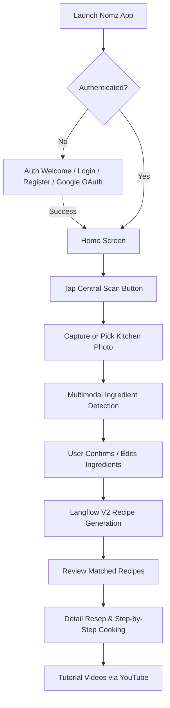
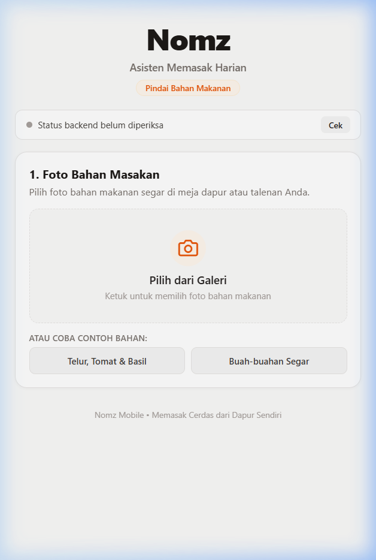
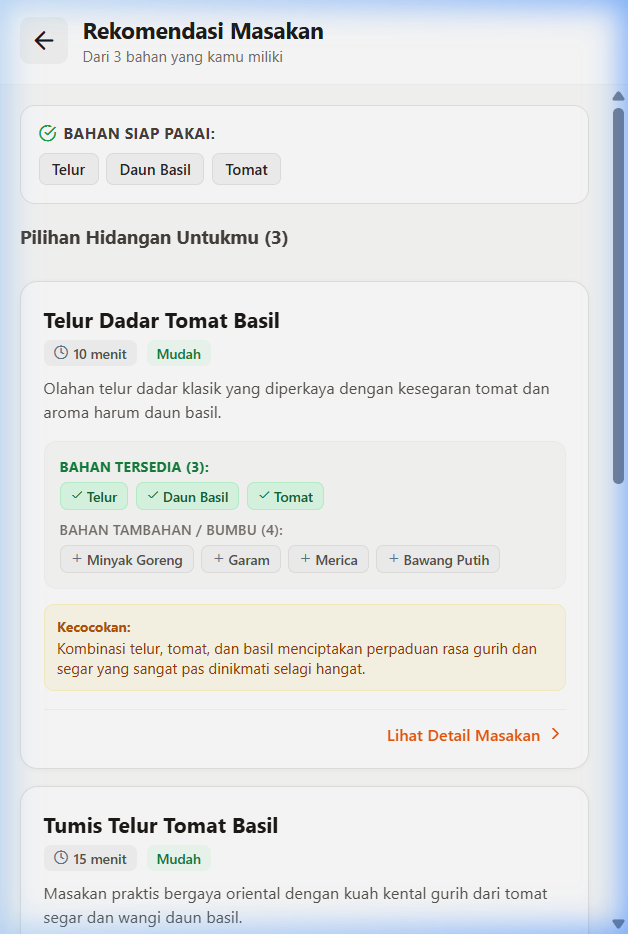
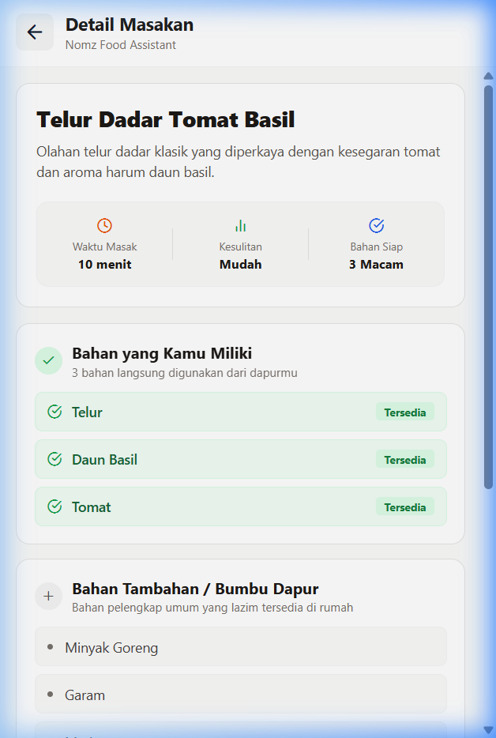

# Nomz — AI Food Rescue Assistant

[](https://github.com/subjectcode/NomzAI/releases/tag/v1.0.0)
[](https://nomz-backend-production.up.railway.app/api/health)
[]()
[]()
[]()

Nomz is a mobile food assistant designed to reduce kitchen food waste by helping users transform whatever ingredients they already have into practical, delicious meals. Nomz flips the traditional recipe workflow: instead of searching for a recipe and buying ingredients, Nomz starts with what is already in your kitchen.

---

## Table of Contents

- [Problem Statement](#problem-statement)
- [Solution](#solution)
- [Core Features](#core-features)
- [End-to-End User Flow](#end-to-end-user-flow)
- [System Architecture](#system-architecture)
- [Technology Stack](#technology-stack)
- [AI & Workflow Orchestration](#ai--workflow-orchestration)
  - [Langflow V2 Orchestration](#langflow-v2-orchestration)
  - [Gemini Multimodal Vision](#gemini-multimodal-vision)
  - [IBM Bob & Model Context Protocol (MCP)](#ibm-bob--model-context-protocol-mcp)
  - [Composio & YouTube Video Discovery](#composio--youtube-video-discovery)
- [Production Infrastructure (Railway + PostgreSQL)](#production-infrastructure-railway--postgresql)
- [Responsible AI & Safety](#responsible-ai--safety)
- [Screenshots](#screenshots)
- [Local Development Setup](#local-development-setup)
- [Environment Variables](#environment-variables)
- [Automated Testing & QA](#automated-testing--qa)
- [Universal Android Compatibility & Release APK](#universal-android-compatibility--release-apk)
- [Presentation & Comprehensive Documentation](#presentation--comprehensive-documentation)
- [Project Directory Structure](#project-directory-structure)
- [Contributors & License](#contributors--license)

---

## Problem Statement

Household food waste frequently occurs because people forget perishable items in their refrigerator or struggle to assemble cohesive recipes from disconnected pantry leftovers. Consumers end up discarding usable ingredients and ordering takeout, wasting both food and household budget.

## Solution

Nomz provides an instant, intelligent bridge from pantry contents to dinner table:
1. **Visual Ingredient Scanning**: Users snap a single photo of ingredients on their kitchen counter or inside their fridge.
2. **AI Multimodal Recognition**: Vision models detect and structure ingredient names automatically in natural Indonesian.
3. **Smart Food Rescue Recipes**: Langflow orchestration synthesizes realistic recipes that prioritize utilizing on-hand items before they spoil, explicitly distinguishing pantry items from minor supplementary staples.
4. **Cooking Assistance & Video Discovery**: Step-by-step cooking timers, instruction checklists, and relevant YouTube tutorials.

---

## Core Features

- **Multimodal Ingredient Detection**: High-accuracy detection via Google Gemini multimodal vision.
- **Recipe Recommendations (Langflow V2)**: Real-time meal generation via Langflow workflows with automatic fallback routing.
- **5-Tab Mobile Navigation**:
  - **Beranda (Home)**: Quick scan shortcuts, food-rescue impact stats, and recommended recipes.
  - **Jelajahi (Explore)**: Recipe exploration by category and cooking style.
  - **Scan (Medallion Action)**: Central quick-access photo capture & ingredient recognition.
  - **Tersimpan (Saved)**: Bookmarked favorite recipes for quick access.
  - **Profil (Profile)**: Account profile management, food waste metrics, pantry stock, cooking history, and meal planner.
- **Authentication & Security**:
  - Google Sign-In (native Google Play Services OAuth 2.0 with backend `id_token` verification).
  - Secure Email/Password registration with 6-digit OTP verification.
  - Persistent encrypted session storage (Remember Me support).
  - Strict account data isolation across PostgreSQL.
- **Kitchen Utilities**:
  - Interactive Pantry inventory management.
  - Guided step-by-step cooking interface with built-in timers.
  - YouTube recipe tutorial video search.

---

## End-to-End User Flow



---

## System Architecture

```text
┌─────────────────────────────────────────────────────────────┐
│                 Nomz Android Mobile Client                  │
│       React Native (Expo SDK 52) · TypeScript · Native UI    │
└──────────────────────────────┬──────────────────────────────┘
                               │ HTTPS (Railway)
                               ▼
┌─────────────────────────────────────────────────────────────┐
│                 FastAPI Gateway Backend                     │
│  PostgreSQL (Railway) · JWT Session · Strict Route Security │
└───┬──────────────────────────┬──────────────────────────┬───┘
    │                          │                          │
    ▼                          ▼                          ▼
┌────────────────────┐  ┌───────────────┐  ┌──────────────────┐
│ Gemini Multimodal  │  │  Langflow V2  │  │ Video Discovery  │
│  Vision Processing │  │ Orchestration │  │ Composio/YouTube │
└────────────────────┘  └───────┬───────┘  └──────────────────┘
                                │
                                ▼
                        ┌───────────────┐
                        │    IBM Bob    │
                        │ MCP Protocol  │
                        └───────────────┘
```

---

## Technology Stack

- **Mobile Client**: React Native 0.76, Expo SDK 52, TypeScript 5.3, React Native Paper / Feather icons.
- **Backend API**: Python 3.11, FastAPI, Pydantic v2, SQLAlchemy, Uvicorn, HTTPX.
- **Database**: PostgreSQL (Production on Railway) with local SQLite compatibility for testing.
- **AI & Orchestration**:
  - Google Gemini (`gemini-3.8-flash` via `google-genai`).
  - Langflow 1.12+ runtime workflows (`find_meals_v2` with V1 fallback).
  - IBM Bob MCP integration (`bob/mcp-config.example.json`).
  - Composio Tool Routing & YouTube Data API v3.
- **Deployment**: Railway HTTPS container deployment with Docker.

---

## AI & Workflow Orchestration

### Langflow V2 Orchestration
Nomz utilizes Langflow for structured recipe synthesis. The workflow normalizes detected ingredient lists, matches flavor profiles, identifies necessary staples, and outputs structured JSON recipes tailored to minimize food waste.

### Gemini Multimodal Vision
Captured images are sent directly to the FastAPI vision service, which prompts Gemini with strict JSON schemas to extract ingredient names in natural Indonesian, filtering non-food objects.

### IBM Bob & Model Context Protocol (MCP)
Nomz includes full support for IBM Bob via Model Context Protocol:
- Configured in `bob/mcp-config.example.json` to expose the `find_meals` workflow to IBM Bob agents.
- Agent instructions in `bob/agent-instructions.md` guide automated tool use and multi-step recipe queries.

### Composio & YouTube Video Discovery
For cooking guidance, Nomz searches verified recipe tutorial videos via Composio orchestration, with seamless fallback to YouTube Data API v3.

---

## Production Infrastructure (Railway + PostgreSQL)

Nomz is deployed live on Railway:
- **Base URL**: `https://nomz-backend-production.up.railway.app`
- **Health Check**: `https://nomz-backend-production.up.railway.app/api/health`
- **Database**: Hosted managed PostgreSQL instance (`railway.internal`).
- **Containerization**: Optimized multi-stage Docker build with zero host-specific dependencies.

---

## Responsible AI & Safety

- **Food Safety & Disclaimer**: The application explicitly reminds users to inspect ingredients for freshness and proper storage condition before consumption.
- **Allergen & Dietary Integrity**: Recipe recommendations flag secondary ingredients that users must independently verify.
- **Data Privacy**: No captured kitchen images or personal credentials are stored permanently or exposed publicly.

---

## Screenshots

| Pindai Bahan (Vision) | Rekomendasi Resep | Detail & Langkah Memasak |
| :---: | :---: | :---: |
|  |  |  |

---

## Local Development Setup

### 1. Prerequisites
- Python 3.11+
- Node.js 18+ & npm
- Docker (for local Langflow, optional if pointing to existing instance)

### 2. Backend Setup
```bash
cd backend
python -m venv .venv
source .venv/bin/activate    # On Windows: .venv\Scripts\activate
pip install -r requirements.txt
cp .env.example .env         # Populate GEMINI_API_KEY, DATABASE_URL, etc.
uvicorn app.main:app --host 0.0.0.0 --port 8000 --reload
```

### 3. Frontend Setup
```bash
cd frontend
npm install
cp .env.example .env         # Set EXPO_PUBLIC_API_URL
npx expo start
```

---

## Environment Variables

### Backend (`backend/.env`)
| Variable | Description |
| :--- | :--- |
| `DATABASE_URL` | PostgreSQL connection URL (or `sqlite:///./nomz.db`) |
| `GEMINI_API_KEY` | Google Gemini API key for vision and fallback |
| `LANGFLOW_BASE_URL` | Langflow server URL (e.g. `http://127.0.0.1:7860`) |
| `LANGFLOW_V2_FLOW_ID` | Langflow V2 flow UUID |
| `GOOGLE_CLIENT_ID` | Google OAuth Web Client ID for backend verification |
| `JWT_SECRET_KEY` | Secret key for signing authentication tokens |
| `YOUTUBE_API_KEY` | Google Cloud API key for YouTube video search |
| `COMPOSIO_API_KEY` | Optional Composio integration key |

### Frontend (`frontend/.env`)
| Variable | Description |
| :--- | :--- |
| `EXPO_PUBLIC_API_URL` | Nomz Backend base URL (`https://nomz-backend-production.up.railway.app`) |
| `EXPO_PUBLIC_GOOGLE_WEB_CLIENT_ID` | Google OAuth Web Client ID |

---

## Automated Testing & QA

Nomz maintains a comprehensive test suite across backend API, AI pipelines, and mobile contract layers:

```bash
# Run 83/83 Pytest test suite
export PYTHONPATH=backend
pytest tests/ -v

# Run TypeScript type check
cd frontend
npx tsc --noEmit
```

- **Backend Pytest**: 83/83 passed (P0 recommendation reliability, auth consistency, password setup, video service, account isolation, Langflow, MCP).
- **TypeScript**: 0 errors.
- **Android E2E & Release QA**: Verified on Android emulators (`emulator-5554`) with complete end-to-end user flows (register/login, profile identity avatar, camera scan, ingredient confirmation, recipe recommendations with back navigation persistence, settings password creation, logout).

## Universal Android Compatibility & Release APK

Nomz provides production-signed standalone Android release artifacts engineered for universal physical device compatibility and optimized download sizes:

### Release Download Options (v1.0.0)

| Artifact | Recommended Use | ABIs | Size | SHA-256 Checksum |
| :--- | :--- | :--- | :--- | :--- |
| **[Nomz-v1.0.0-android-universal.apk](https://github.com/subjectcode/NomzAI/releases/download/v1.0.0/Nomz-v1.0.0-android-universal.apk)** | **Recommended (Universal)** | `arm64-v8a`, `armeabi-v7a`, `x86_64` | **38.89 MB** (40,783,794 B) | `2e892663d8a120273232b30d49a6d6655deea817eb7b51cf31142173ef4a470d` |
| **[Nomz-v1.0.0-android-arm64.apk](https://github.com/subjectcode/NomzAI/releases/download/v1.0.0/Nomz-v1.0.0-android-arm64.apk)** | Optional (Modern 64-bit phones) | `arm64-v8a` | **25.05 MB** (26,265,678 B) | `8a8b7d7af4d0008555abbc962fed5a51a73fcfebaa4f17bde2f369d755bea761` |
| **[Nomz-v1.0.0-android-arm32.apk](https://github.com/subjectcode/NomzAI/releases/download/v1.0.0/Nomz-v1.0.0-android-arm32.apk)** | Optional (Older 32-bit phones) | `armeabi-v7a` | **24.10 MB** (25,271,718 B) | `f88436eaea804381252f0ec1080b79fe845dfe7fe6bd61013c5e358703f46180` |
| **Nomz-v1.0.0-android.aab** | Google Play Store Bundle | `arm64-v8a`, `armeabi-v7a`, `x86_64` | **49.00 MB** (51,378,449 B) | `cb5cf26ec2b605a67497d02342fa531572426cbedd0343a22b0e08e54da0d83f` |

- **Application ID**: `com.nomz.app`
- **Min Android SDK**: Android 7.0 (API 24) — covers 99.5%+ of active devices globally
- **Target Android SDK**: Android 16 (API 36)
- **Compatibility Fix**: Resolved earlier `INSTALL_FAILED_NO_MATCHING_ABIS` failure caused by emulator-only architecture targeting; the APK now bundles full ARM native libraries (`lib/arm64-v8a/` and `lib/armeabi-v7a/`).
- **Size Optimization**: Native `.so` libraries were uncompressed by default (`expo.useLegacyPackaging=false`), resulting in a 75.52 MB universal APK. By enabling legacy ZIP packaging (`expo.useLegacyPackaging=true`), the universal APK compressed size dropped by **46.0%** to **38.89 MB**, while dedicated ARM64 dropped by **65.2%** to **25.05 MB**.
- **Signature Verification**: Verified with v2 scheme using official Nomz production certificate (`SHA-256: 6c82dc39869fbf39ae591b6d64c21f0a141807b45c6d49413d97cdd102162b34`).

---

## Presentation & Comprehensive Documentation

Comprehensive materials prepared for hackathon judges, developers, and deployment engineers:
- **[Project Overview](docs/PROJECT_OVERVIEW.md)**: Problem statement, UVP, user journey, impact model, and monetization.
- **[System Architecture](docs/ARCHITECTURE.md)**: End-to-end architecture diagrams, security isolation, and service contracts.
- **[11-Slide Pitch Outline](docs/PRESENTATION_OUTLINE.md)**: Slide-by-slide messages, visuals, speaker notes, and transitions.
- **[Live Demo Script](docs/DEMO_SCRIPT.md)**: 3–5 minute step-by-step demonstration walkthrough with edge-case fallbacks.
- **[Testing & Release Guide](docs/TESTING_AND_RELEASE.md)**: Pytest verification, device compatibility matrix, and APK installation guide.
- **[Responsible AI Manifesto](docs/RESPONSIBLE_AI.md)**: Food-safety boundaries, sensory limitations, and user-confirmation safeguards.

---

## Project Directory Structure

```text
Nomz/
├── backend/
│   ├── app/
│   │   ├── api/routes/          # Auth, Health, Vision, Recommendations, Videos
│   │   ├── core/                # Configuration and security settings
│   │   ├── db/                  # SQLAlchemy models and session engine
│   │   ├── schemas/             # Pydantic validation schemas
│   │   └── services/            # Vision, Auth, OTP, Langflow client, YouTube
│   ├── Dockerfile               # Railway deployment configuration
│   ├── Procfile                 # Process launcher
│   └── requirements.txt
├── bob/
│   ├── agent-instructions.md    # IBM Bob system prompts
│   └── mcp-config.example.json  # MCP tool specification for IBM Bob
├── frontend/
│   ├── android/                 # Bare Android native release project
│   ├── src/
│   │   ├── components/          # BottomNavBar, GoogleSignInButton, NomzLogo
│   │   ├── context/             # AuthContext session provider
│   │   ├── screens/             # Beranda, Jelajahi, Scan, Detail, Profile, Auth
│   │   ├── services/            # API clients, Google Auth, Storage
│   │   └── theme/               # Design tokens, palette
│   └── package.json
├── langflow/
│   ├── components/              # Custom Langflow Python nodes
│   └── flows/                   # Exported workflow graphs (V1, V2, OTP)
├── screenshots/                 # Application preview screenshots
├── tests/                       # Pytest test suite (78 tests)
└── .github/                     # Issue & PR templates
```

---

## Contributors & License

- **Repository**: [subjectcode/NomzAI](https://github.com/subjectcode/NomzAI)
- **Developed for**: Hackathon 2026
