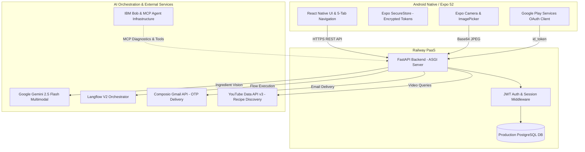

# Nomz — System Architecture & Technical Specifications

## 1. System Overview

Nomz operates as a modern cloud-backed mobile application designed for low latency, high resilience, and multi-layered AI orchestration.

---

## 2. Frontend Architecture
- **Framework**: React Native 0.86 with Expo SDK 52.
- **Language**: TypeScript (`npx tsc --noEmit` clean).
- **Navigation**: Custom persistent bottom navigation bar (`BottomNavBar.tsx`):
  - `Beranda` (Home)
  - `Jelajahi` (Explore)
  - `Scan` (Medallion floating action button)
  - `Tersimpan` (Saved Recipes)
  - `Profil` (Profile & Utilities)
- **Local State & Storage**:
  - `AuthContext`: Centralized authentication provider managing tokens, user profile, and Remember-Me persistence.
  - `@react-native-async-storage/async-storage`: Lightweight application preferences.
  - `expo-secure-store`: Encrypted keystore/keychain storage for JWT tokens and refresh credentials.
- **Network Resilience**:
  - Configurable React Native fetch engine (`EXPO_PUBLIC_USE_RN_FETCH=1`).
  - Production HTTPS endpoints with timeout fallbacks (`https://nomz-backend-production.up.railway.app`).

---

## 3. Backend Architecture
- **Framework**: Python 3.11 + FastAPI with Uvicorn ASGI.
- **Data Persistence**: SQLAlchemy ORM with PostgreSQL on Railway (automatic fallback to SQLite for isolated local testing).
- **Database Schema**:
  - `users`: Account identity, hashed passwords, provider type (local/google), creation timestamp.
  - `user_profiles`: Preferences, food waste score, total saved items.
  - `pantry_items`: User-specific ingredient inventory with quantity and expiration timestamps.
  - `saved_recipes`: User bookmarks referencing recipe identifiers and metadata.
  - `cooking_history`: Completed recipe logs with dates and meal ratings.
  - `meal_plans`: Scheduled recipes across calendar days.
- **Data Isolation**: Strict user-id scoping across all ORM queries; no user can access or modify another account's pantry, saved recipes, or cooking logs.

---

## 4. AI & Service Orchestrations

### A. Google Gemini Multimodal Vision
- Receives kitchen counter or refrigerator images encoded in base64.
- Prompt engineered to extract recognized ingredients strictly as structured JSON arrays with standard Indonesian ingredient names.
- Returns confidence flags and distinguishes primary ingredients from pantry condiments.

### B. Langflow V2 Orchestration
- Orchestrates recipe synthesis based on on-hand ingredients, user dietary preferences, and target meal categories.
- Implements resilient multi-engine routing:
  1. Langflow remote pipeline invocation (`find_meals_v2`).
  2. Local Gemini structured generation if Langflow remote is unavailable.
  3. Curated culinary catalog fallback if external AI endpoints encounter rate limits or network partitions.
- Implements deterministic recipe deduplication and recommendation caching to ensure sub-second response times and preserve state when users navigate back from recipe details.

### C. IBM Bob & Model Context Protocol (MCP)
- IBM Bob serves as the autonomous coding and systems development partner.
- Standardized MCP server contracts provide tools for database inspection, pipeline tracing, and rapid backend debugging during hackathon iterations.

### D. Composio Gmail OTP Integration
- Generates secure, single-use 6-digit numeric verification codes.
- Uses Composio tools connected to Gmail API to transmit responsive OTP emails for new account registration.
- Backend verifies OTP against an HMAC-signed salt and expiration window (10 minutes).

### E. YouTube Recipe Discovery
- Leverages YouTube Data API v3 with a specialized relevance ranker (`video_relevance_ranker.py`).
- Matches cooking tutorials matching Indonesian recipe names, filtering out irrelevant lifestyle vlogs.

---

## 5. Security & Session Integrity
- **JWT Authentication**: Passwords hashed using `bcrypt` (cost factor 12). Sessions verified using HMAC-SHA256 JWTs.
- **Google OAuth**: Mobile client acquires Google `id_token` via official Play Services SDK; FastAPI verifies token signature with Google's public JWKS endpoint.
- **Secret Separation**: All production secrets (database URLs, API keys, JWT signing keys) injected strictly via environment variables. Zero credentials committed to version control.
