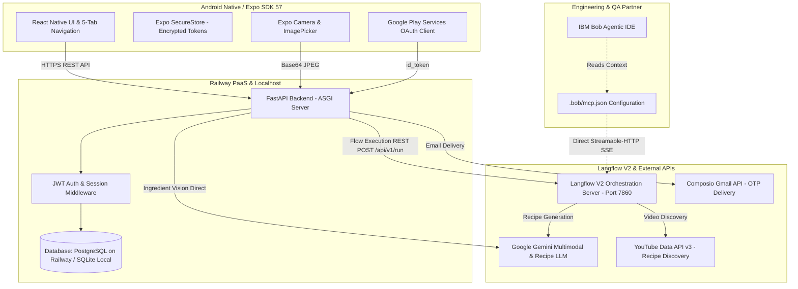

# Nomz — System Architecture & Technical Specifications

## 1. System Overview & Dual-Ecosystem Model

Nomz dirancang dengan pemisahan tegas antara **Runtime Aplikasi Pengguna (Production)** dan **Lingkungan Bantuan Rekayasa (Development Tooling)**:

---

## 2. Klarifikasi Komponen: Runtime vs. Tooling

| Aspek | Langflow V2 | IBM Bob | Model Context Protocol (MCP) |
| :--- | :--- | :--- | :--- |
| **Kategori** | Runtime AI Workflow Engine | Autonomous Coding & QA Assistant | Open Integration Protocol |
| **Lokasi Eksekusi** | Docker Container (Port 7860) | Desktop Developer Environment | Standar komunikasi (JSON-RPC SSE) |
| **Aktor Pemicu** | Panggilan backend FastAPI saat user meminta resep di HP | Engineer saat mengembangkan, merekayasa kode, atau menjalankan tes | Agent Bob saat memanggil tools di Langflow |
| **Peran di Nomz** | Menjalankan pipeline multi-node `find_meals_v2` secara sinkron | Membantu refactoring kode, verifikasi schema Pydantic, dan hardening APK | Menyediakan interface tools `find_meals` dan `email_otp_sender` bagi Bob |

---

## 3. Frontend Architecture
- **Framework**: React Native `0.86.3` with Expo SDK `57.0.25`, React `19.2.3`.
- **Language**: TypeScript (`npx tsc --noEmit` clean, 0 errors).
- **Navigation**: Custom persistent 5-tab navigation bar (`BottomNavBar.tsx`):
  - `Beranda` (Home) — Ringkasan dampak, quick scan, resep unggulan.
  - `Jelajahi` (Explore) — Katalog resep terorganisir per-kategori.
  - `Scan` (Medallion FAB) — Scanner kamera & galeri foto bahan makanan.
  - `Tersimpan` (Saved) — Resep favorit tersimpan lokal & cloud.
  - `Profil` (Profile) — Inventaris dapur, histori memasak, meal planner, dan skor food-waste.
- **Local State & Storage**:
  - `AuthContext`: Pengelolaan sesi token JWT dan auto-restore credentials.
  - `@react-native-async-storage/async-storage`: Preferensi tampilan dan cache resep.
  - `expo-secure-store`: Penyimpanan terenkripsi untuk token akses sensitif.
- **Network Resilience**:
  - Dukungan engine `RN fetch` (`EXPO_PUBLIC_USE_RN_FETCH=1`) untuk kompatibilitas upload multipart di berbagai platform mobile.

---

## 4. Backend Architecture
- **Framework**: Python 3.11 + FastAPI dengan Uvicorn ASGI server.
- **Data Persistence**: SQLAlchemy ORM di `backend/app/db/database.py`.
  - **Production**: PostgreSQL di Railway Cloud dengan connection pooling (`pool_pre_ping=True`).
  - **Local Development & Automated Tests**: SQLite (`nomz.db`) terisolasi untuk eksekusi cepat dan reproducible.
- **Database Schema**:
  - `users`: Identitas akun, password hash (`bcrypt`), status verifikasi, dan provider Google OAuth.
  - `user_profiles`: Profil preferensi dapur, skor penyelamatan pangan, kuota harian.
  - `pantry_items`: Inventaris stok bahan pengguna dengan jumlah dan tanggal kedaluwarsa.
  - `saved_recipes`: Bookmark resep masakan favorit per-pengguna.
  - `cooking_history`: Riwayat memasak dengan timestamp dan rating kepuasan.
  - `meal_plans`: Jadwal memasak mingguan terintegrasi.
- **Data Isolation**: Isolasi ketat berbasis `user_id` di setiap query ORM (*Strict Tenant Isolation*).

---

## 5. AI & External Service Orchestrations

### A. Google Gemini Multimodal Vision
- Menerima foto bahan mentah (base64 JPEG) dari kamera aplikasi.
- Dieksekusi melalui endpoint backend `/api/vision/detect-ingredients` menggunakan SDK resmi `google-genai` (`gemini-3.8-flash`).
- Menghasilkan daftar bahan masakan terstandarisasi dalam Bahasa Indonesia.

### B. Langflow V2 Orchestration (`find_meals_v2`)
- Di-host pada Docker container port 7860 (`flow_id: 9b196854-4746-49e7-ad92-f67f06c054ff`).
- Terdiri dari 10 nodes terintegrasi:
  1. **Chat Input**: Menerima daftar bahan confirmed dari backend.
  2. **Ingredient Normalizer**: Standarisasi penamaan bahan lokal.
  3. **Cooking Style Interpreter**: Menyesuaikan preferensi (tumis, rebus, goreng, hemat bumbu).
  4. **Rescue Prompt Builder**: Membangun system prompt anti-waste.
  5. **Google Generative AI**: LLM inference menggunakan Gemini 2.5 Flash Lite.
  6. **Recipe Validator & Formatter**: Menjamin integritas bahan (bahan wajib harus cocok dengan input user).
  7. **Video Search Intent**: Merumuskan kata kunci pencarian video tutorial memasak.
  8. **YouTube Search Tool**: Eksekusi pencarian API YouTube Data API v3 secara live.
  9. **Video Relevance Ranker**: Menyaring dan memeringkat video tutorial Indonesia yang relevan.
  10. **Chat Output**: Mengirimkan payload JSON terstruktur ke backend.

### C. IBM Bob & Model Context Protocol (MCP)
- IBM Bob bertindak sebagai mitra rekayasa perangkat lunak otonom selama siklus pengembangan.
- File `.bob/mcp.json` menghubungkan Bob secara langsung ke Langflow MCP Server via SSE streamable-http.
- Memungkinkan Bob melakukan verifikasi tools, testing respons masakan, dan inspeksi integritas sistem.

---

## 6. Security, Session & Quality Assurance
- **Password Hashing**: Menggunakan `bcrypt` dengan salt dinamis.
- **Token Security**: HMAC-SHA256 JWT dengan masa kedaluwarsa ketat.
- **Google OAuth Verification**: Verifikasi cryptographic signature token Google menggunakan Google JWKS public certs.
- **Testing Coverage**: Automated Pytest suite menguji health endpoint, integrasi Langflow REST, isolasi data, dan handshake protokol MCP.
